<div align="center">

# IsoDAQ Studio

**A serial terminal and real-time data-acquisition frontend for embedded systems development.**

Built with **Python 3 · PyQt6 · pyqtgraph** — runs on **Windows · Linux · macOS**.

[](https://github.com/AlexShateljuk/isodaq/actions/workflows/ci.yml)
[](LICENSE)
[](https://github.com/AlexShateljuk/isodaq/wiki)

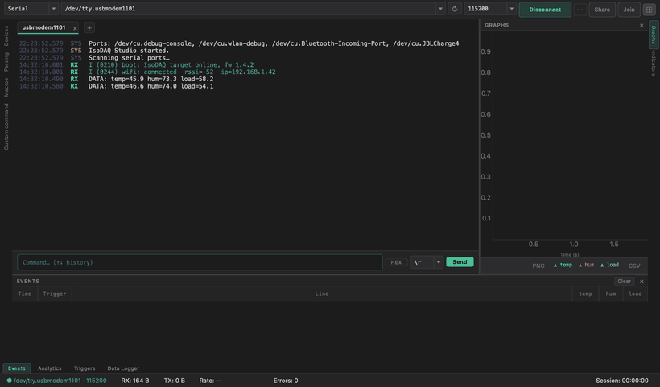

*Connect · parse channels · plot live · fire alerts — and [share the session](#session-sharing-share--join) with anyone.*

</div>

> Connect to one or **several devices at once** — over USB serial, TCP/RFC2217 or
> SSH — watch the traffic scroll by with millisecond timestamps and log-level
> colouring (or as a **hex dump**), pull named numeric channels out of the stream,
> plot them live, fire alerts on the lines that matter, log everything to
> CSV + SQLite, and share the whole session with a colleague anywhere in the
> world — all from one IDE-style window.

---

## Why IsoDAQ Studio?

Most serial tools do one thing — a terminal, *or* a plotter. IsoDAQ Studio pulls
the whole embedded-debug loop into one window: **read → parse → plot → alert →
log → share**.

| | **IsoDAQ Studio** | PuTTY | Arduino Serial Monitor | Serial Studio | Teleplot |
|---|:---:|:---:|:---:|:---:|:---:|
| Cross-platform (Win / Linux / macOS) | ✅ | ✅ | ✅ | ✅ | VS Code |
| Full serial terminal | ✅ | ✅ | basic | ➖ | ❌ |
| **Several devices at once** (one tab each) | ✅ | separate windows | ❌ | ❌ | ❌ |
| Network (TCP / RFC2217) & SSH sources | ✅ | ✅ | ❌ | ✅ | ➖ |
| HEX view (offset · bytes · ASCII) | ✅ | ❌ | ❌ | ➖ | ❌ |
| Live plots | ✅ | ❌ | basic | ✅ | ✅ |
| Named-channel parsing (KEY=VALUE / JSON) | ✅ | ❌ | ❌ | ✅ | ✅ |
| Value dashboards / indicators | ✅ | ❌ | ❌ | ✅ | ➖ |
| Triggers / alerts on matching lines | ✅ | ❌ | ❌ | ❌ | ❌ |
| Webhook / Telegram notifications | ✅ | ❌ | ❌ | ❌ | ❌ |
| Data logging (CSV **+** SQLite) | ✅ | raw log | ❌ | CSV | ❌ |
| Log-level colouring (ESP-IDF / Zephyr / …) | ✅ | ❌ | ❌ | ❌ | ❌ |
| Command macros / sequences | ✅ | ❌ | ❌ | ❌ | ❌ |
| **Remote session sharing** | ✅ | ❌ | ❌ | ❌ | ❌ |
| Free & open source | ✅ | ✅ | ✅ | ✅ | ✅ |

What's genuinely different: **several devices side by side**, each with its own
parser, charts and triggers; **triggers + notifications** on the lines that matter;
per-platform **log colouring**; command **macros**; and **remote session sharing** —
stream a board's live output to a colleague anywhere, no screen-share, no account.
It is built for fast links too: several ports at **921 600 baud** and flash dumps
are logged without losing a line (see [Performance](#performance)).

---

## 📖 Documentation

This README is the **overview with pictures**. For a **detailed, page-per-feature
guide**, see the **[Wiki](https://github.com/AlexShateljuk/isodaq/wiki)**:

| Getting started | Working with data | Automation & sharing |
|-----------------|-------------------|----------------------|
| [Getting Started](https://github.com/AlexShateljuk/isodaq/wiki/Getting-Started) | [Data Parser](https://github.com/AlexShateljuk/isodaq/wiki/Data-Parser) | [Triggers](https://github.com/AlexShateljuk/isodaq/wiki/Triggers) |
| [Interface Overview](https://github.com/AlexShateljuk/isodaq/wiki/Interface-Overview) | [Live Views](https://github.com/AlexShateljuk/isodaq/wiki/Live-Views) | [Macros](https://github.com/AlexShateljuk/isodaq/wiki/Macros) |
| [Serial Connection](https://github.com/AlexShateljuk/isodaq/wiki/Serial-Connection) | [Data Logger](https://github.com/AlexShateljuk/isodaq/wiki/Data-Logger) | [Session Sharing](https://github.com/AlexShateljuk/isodaq/wiki/Session-Sharing) |
| [Terminal](https://github.com/AlexShateljuk/isodaq/wiki/Terminal) | [Log Colorizer](https://github.com/AlexShateljuk/isodaq/wiki/Log-Colorizer) | [Themes, Modes & Settings](https://github.com/AlexShateljuk/isodaq/wiki/Themes-Modes-and-Settings) |
| [Multiple Connections](https://github.com/AlexShateljuk/isodaq/wiki/Multiple-Connections) | [Performance & High Data Rates](https://github.com/AlexShateljuk/isodaq/wiki/Performance-and-High-Data-Rates) | [FAQ & Troubleshooting](https://github.com/AlexShateljuk/isodaq/wiki/FAQ-and-Troubleshooting) |

---

## Contents

- [Quick start](#quick-start)
- [Pre-built binaries](#pre-built-binaries)
- [The interface at a glance](#the-interface-at-a-glance)
- [Features](#features)
- [Architecture](#architecture)
- [Project structure](#project-structure)
- [Performance](#performance)
- [Contributing](#contributing) · [Security](#security) · [License](#license)

---

## Quick start

### Running from source

```bash
git clone https://github.com/AlexShateljuk/isodaq.git
cd isodaq
pip install -r requirements.txt
python main.py
```

Requirements: Python 3.9+, see `requirements.txt` for package versions.

### Pre-built binaries

Download the latest release for your platform from the
[Releases](https://github.com/AlexShateljuk/isodaq/releases) page.

| Platform | File | How to run |
|----------|------|-----------|
| Windows 10/11 x64 | `IsoDAQ-Studio-windows-x64.zip` | Extract → run `IsoDAQ Studio.exe` |
| Linux x64 | `IsoDAQ-Studio-linux-x64.tar.gz` | Extract → `chmod +x "IsoDAQ Studio"` → run `./IsoDAQ\ Studio` |
| macOS Apple Silicon (M1+) | `IsoDAQ-Studio-macos-arm64.zip` | Extract → drag `IsoDAQ Studio.app` to Applications |
| macOS Intel | *(no pre-built binary)* | Run from source — see [Running from source](#running-from-source) |

> **Intel Macs:** GitHub's Intel CI runners are being retired and can queue for
> hours, so releases ship an Apple-Silicon (arm64) build only. IsoDAQ Studio is
> a pure-Python app, so on an Intel Mac just run it from source
> (`pip install -r requirements.txt && python main.py`).

> **Unsigned builds:** releases are not code-signed/notarized (no paid
> certificates), so the OS shows a first-run warning. This is expected.
> - **macOS** — Gatekeeper says *"unidentified developer"*: **right-click the
>   app → Open → Open**, once. (If you see *"damaged"*, remove the quarantine
>   flag: `xattr -dr com.apple.quarantine "IsoDAQ Studio.app"`.)
> - **Windows** — SmartScreen shows *"Windows protected your PC"*: click
>   **More info → Run anyway**.

> **Linux note:** if the app does not start, install the Qt platform plugin dependencies:
> ```bash
> sudo apt-get install libxcb-cursor0 libxcb-xinerama0 libegl1
> ```

More detail: **[Getting Started](https://github.com/AlexShateljuk/isodaq/wiki/Getting-Started)** ·
**[Building from source](https://github.com/AlexShateljuk/isodaq/wiki/Building-From-Source)**.

---

## The interface at a glance

An IDE-style window (think IntelliJ / VS Code): the **terminal** is the editor in
the middle, and every other feature is a **tool window** docked to the left,
right or bottom edge. Click a name on an edge **stripe** to open it, click again to
collapse it — so the terminal can take the whole window when you want it to.

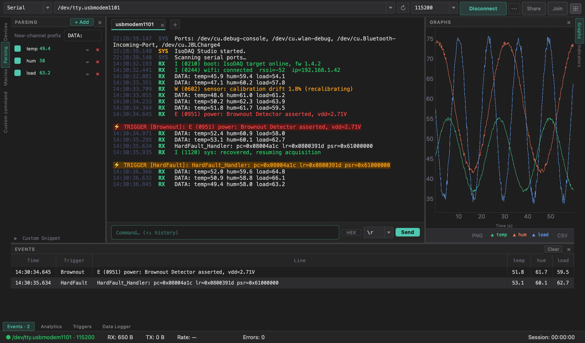

| Region | What it does |
|--------|--------------|
| **Connection toolbar** (top) | Transport (Serial / Network / SSH), port or URL, baud, Connect, `⋯` options, Share & Join |
| **Connection tabs** | One tab per device; `+` adds one. Everything below follows the active tab |
| **Terminal** (centre) | Timestamped, colour-coded RX/TX, log-level highlighting, **HEX** view; `Ctrl+F` searches |
| **Command input** | Send line + `HEX` toggle + EOL selector, `↑ ↓` command history |
| **Left tool windows** | Devices · Parsing · Macros · Custom command |
| **Right tool windows** | Graphs · Indicators |
| **Bottom tool windows** | Events · Analytics · Triggers · Data Logger |
| **Status bar** | Connection state, RX/TX bytes, live line rate, errors, session time |

Press **`Ctrl/Cmd+K`** for the **command palette** — fuzzy-search any action,
tool window, device or setting. `F4` detaches the open tool window into its own
window. Two layout modes (**Advanced** / **Simple**), two themes (**Dark** /
**Light**) and the open tool windows are persisted across sessions.
→ **[Interface Overview](https://github.com/AlexShateljuk/isodaq/wiki/Interface-Overview)**

---

## Features

### Connections — serial, network, SSH, several at once

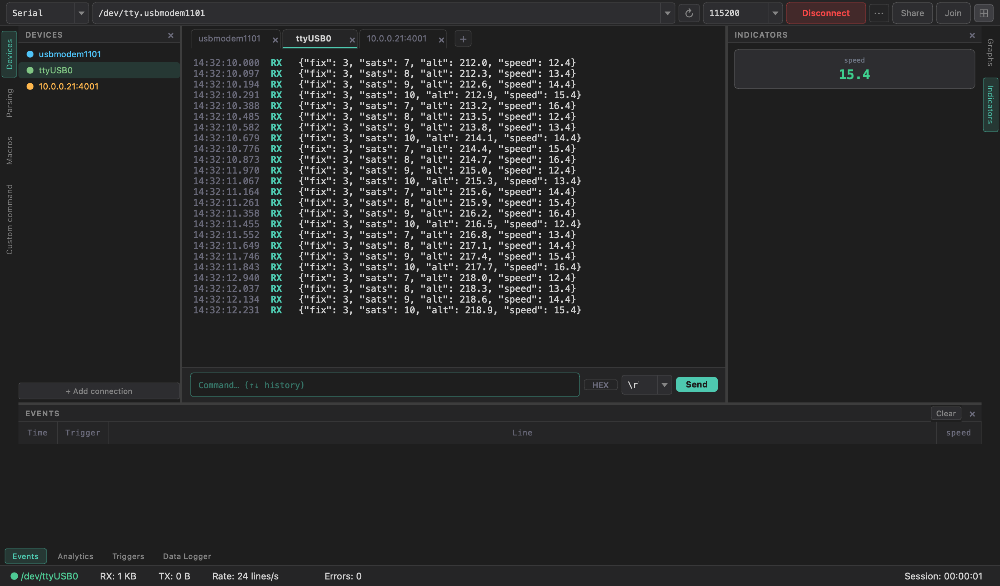

- **Serial** — port, baud rate (9 600 – 921 600), data bits, parity, stop bits, flow control (None / RTS/CTS / XON/XOFF)
- **Network** — `socket://host:port` (raw TCP, ser2net/socat bridges) and `rfc2217://host:port` (Moxa, Digi, Lantronix…)
- **SSH** — stream a remote command's output (e.g. `cat /dev/ttyUSB0` on a Raspberry Pi); saved sessions, password never stored
- **Multiple connections** — one tab per device, each with its own terminal, parser, charts, indicators, triggers, events, analytics and logger. Triggers fire on every connection, even background tabs. The **Devices** tool window lists them all: ● connected · ○ idle · ✕ failed / link lost
- Status bar per device: RX/TX bytes, live **line rate**, error count, session time
- Partial-line flush: incomplete lines without a trailing `\n` are emitted after 250 ms of silence; over-long runs (binary / flash dumps) are split at 4 KB
- Automatic disconnect detection; configurable EOL (`\r\n` / `\n` / `\r` / none); command history (↑ ↓)

→ **[Serial Connection guide](https://github.com/AlexShateljuk/isodaq/wiki/Serial-Connection)** ·
**[Multiple Connections](https://github.com/AlexShateljuk/isodaq/wiki/Multiple-Connections)**

### Terminal

- Monospace output with millisecond timestamps
- **HEX view** — one click on `HEX` shows received data as a classic hex dump with
  a running byte offset; every byte is shown, including CR/LF. Ideal for flash
  dumps and binary protocols:

  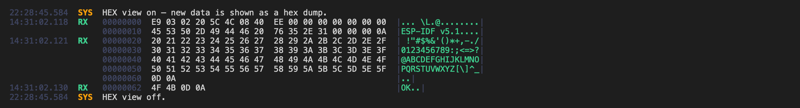
- Autoscroll toggle with manual override
- Echo TX back to terminal
- Adjustable font size (8 – 24 pt), persisted across sessions
- Configurable scrollback limit (default 5 000 lines)
- Colour-coded lines: RX · TX · SYS · ERR

→ **[Terminal guide](https://github.com/AlexShateljuk/isodaq/wiki/Terminal)**

### Command palette

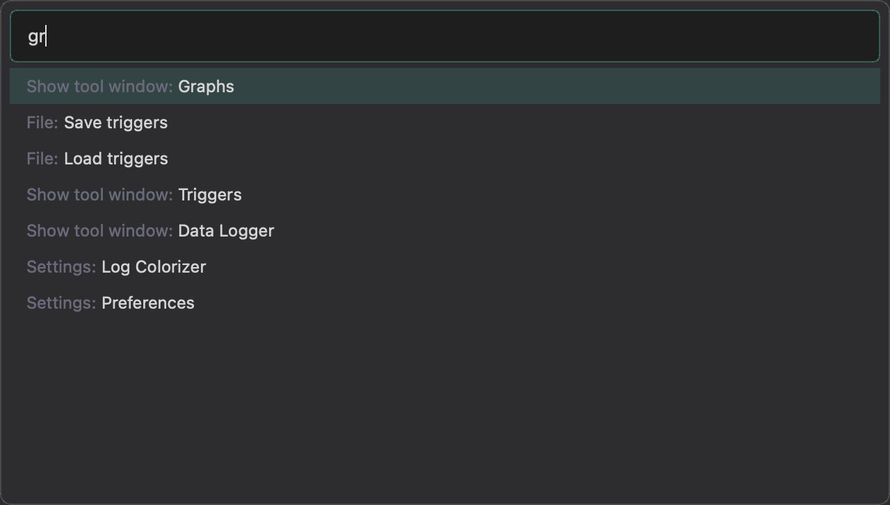

`Ctrl/Cmd+K` (or `Ctrl/Cmd+Shift+P`) opens a fuzzy search over everything the app
can do: connect / disconnect, switch device, open any tool window, toggle HEX,
timestamps or autoscroll, change theme, and every menu item. `↑ ↓` to pick,
`Enter` to run, `Esc` to close.

### Log Colorizer

Highlights RX lines by log level based on the active platform profile.

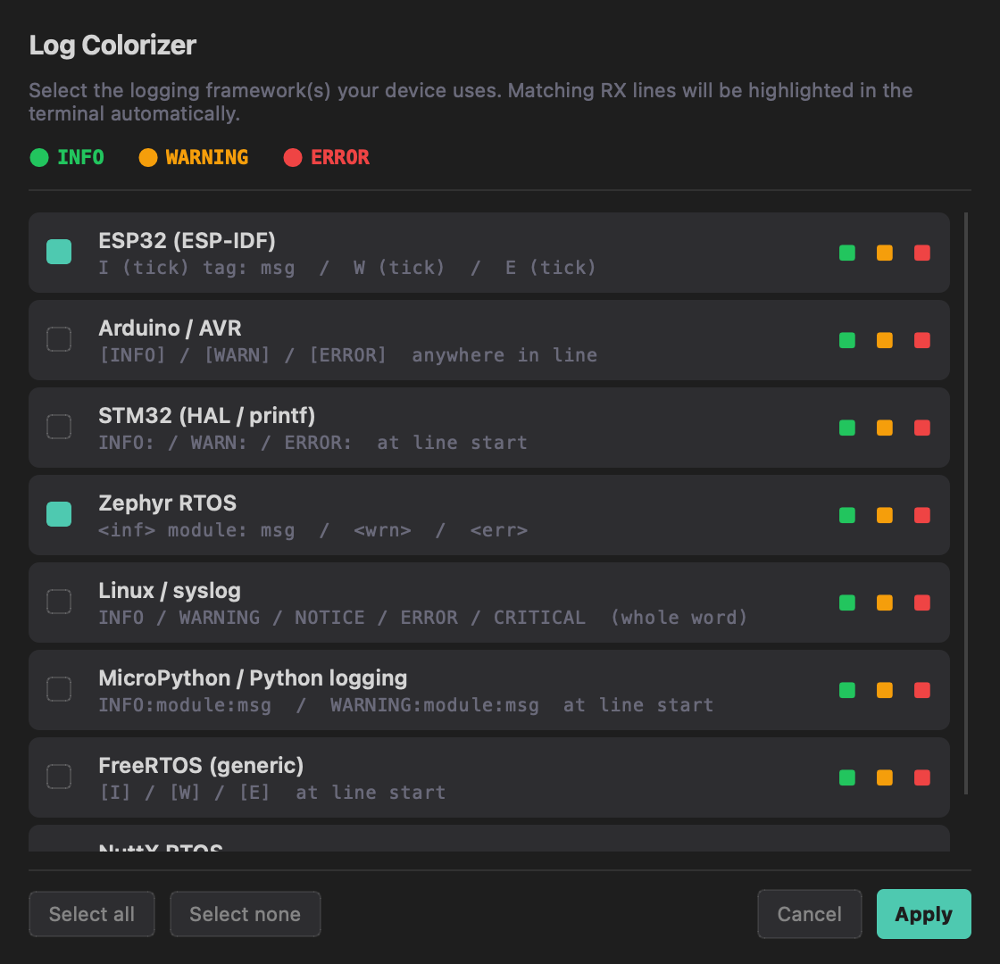

| Colour | Level |
|--------|-------|
| Green  | INFO |
| Yellow | WARNING / NOTICE |
| Red    | ERROR / CRITICAL |

Supported platforms: ESP32 (ESP-IDF), Arduino / AVR, STM32 (HAL / printf), Zephyr RTOS,
Linux / syslog, MicroPython / Python logging, FreeRTOS (generic), NuttX RTOS.
Multiple platforms can be active simultaneously (`Settings → Log Colorizer…`).

→ **[Log Colorizer guide](https://github.com/AlexShateljuk/isodaq/wiki/Log-Colorizer)**

### Data parser

Extracts named numeric channels from RX lines in real time.

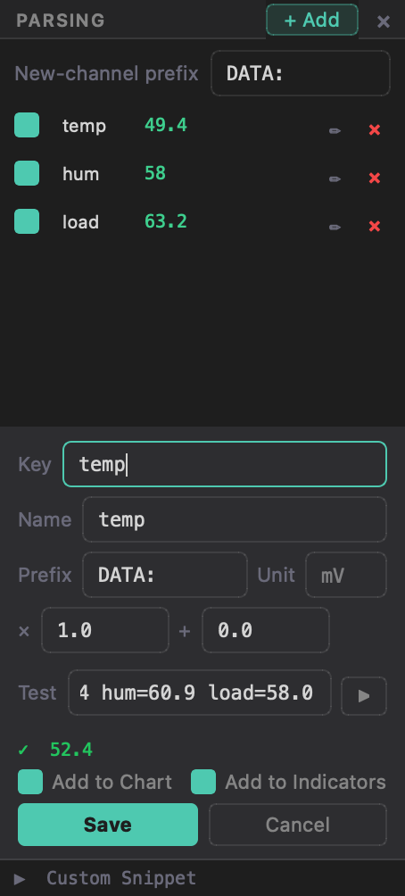

| Field | Purpose |
|-------|---------|
| Key | Token to search for (`snap.pv_v`, `vbat`, `data.voltage`) |
| Prefix | Line filter — only lines containing this string are parsed |
| Unit | Disambiguates multiple tokens (`pv=43608mV 847mA` → Unit `mV` → `43608`) |
| × / + | Scale and offset applied after extraction |

No "mode" to pick — the extractor auto-detects **JSON** objects and
**KEY=VALUE** / `key: value` tokens per line; for anything else, a **custom
Python snippet** can extract channels however you like. A built-in **Test** field
verifies extraction against a sample line before you commit a channel, and
**New-channel prefix** at the top of the section pre-fills the prefix for new channels.

Parsed values feed the **Graphs**, **Indicators**, and **Trigger Events** views.
Every connection has its own channels.

→ **[Data Parser guide](https://github.com/AlexShateljuk/isodaq/wiki/Data-Parser)**

<br clear="right">

### Live views

Each view is a tool window; press `F4` (View → Detach Tool Window) to pop the open
one out into its own resizable window — it docks back when you close it.

| Graphs | Indicators |
|--------|------------|
| 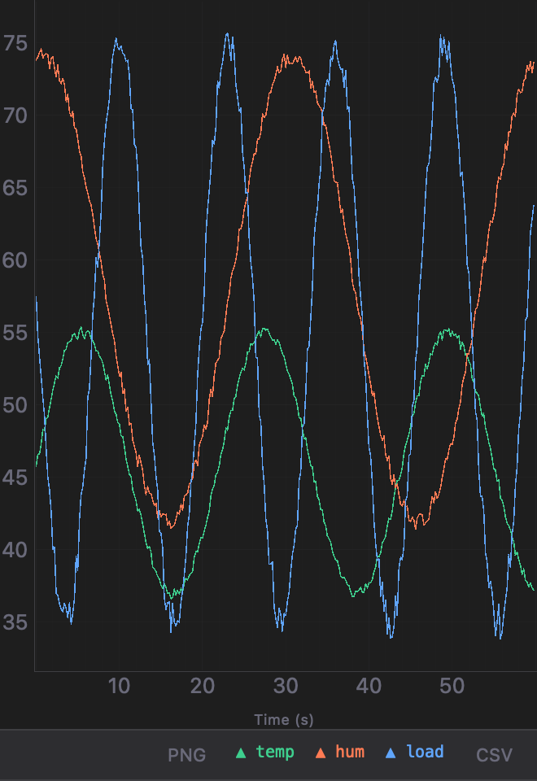 | 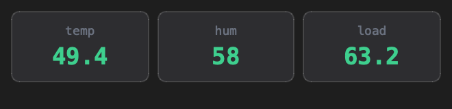 |
| Real-time scrolling chart (pyqtgraph): up to 8 channels, 60-second rolling window, 20 000-point ring buffer per channel, mouse pan/zoom, PNG/CSV export. | Live value grid — one large monospace card per channel, with per-card colour thresholds (double-click a card to edit). |

| Trigger Events | Analytics |
|----------------|-----------|
| 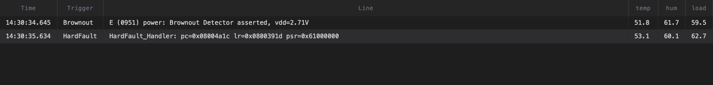 | 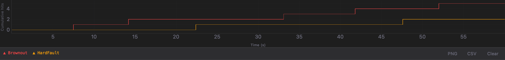 |
| Session log of every trigger match: **Time · Trigger · Raw line** + one column per active parsed channel. Double-click a row to jump back to that line in the terminal. | Cumulative per-trigger hit count as a staircase over time — bursts and quiet periods stand out at a glance. PNG/CSV export. |

→ **[Live Views guide](https://github.com/AlexShateljuk/isodaq/wiki/Live-Views)**

### Triggers

Alert rules evaluated against every incoming RX line in real time.

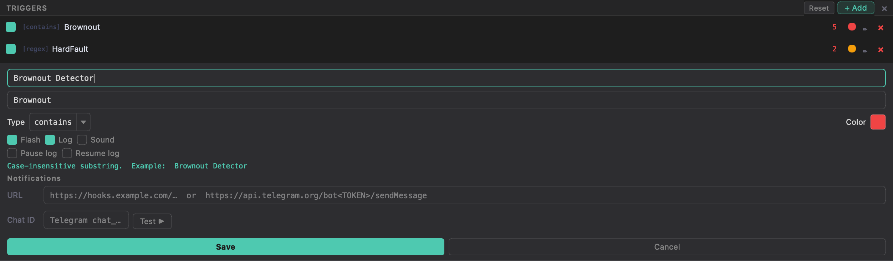

| Syntax | Example |
|--------|---------|
| Plain text (case-insensitive) | `Brownout Detector` |
| Regex | `[regex] hard.?fault\|HardFault_Handler\|ERR_\d+` |
| Python lambda | `[python] lambda line: 'ERR' in line and '=' in line` |

Actions per trigger: **Flash** (coloured banner) · **Log** (marker in log file) ·
**Sound** (system beep) · **Pause log** · **Resume log**, plus optional
**webhook / Telegram notifications**.

Hit counters per trigger update live and reset on session clear.
Triggers are saved and loaded as JSON (`File → Save triggers… / Load triggers…`).

> ⚠️ `[python]` triggers execute arbitrary code by design. Files loaded from an
> untrusted source keep their Python rules **blocked** until you review and enable them.

→ **[Triggers guide](https://github.com/AlexShateljuk/isodaq/wiki/Triggers)**

<br clear="right">

### Macros

Configurable command sequences sent over serial.

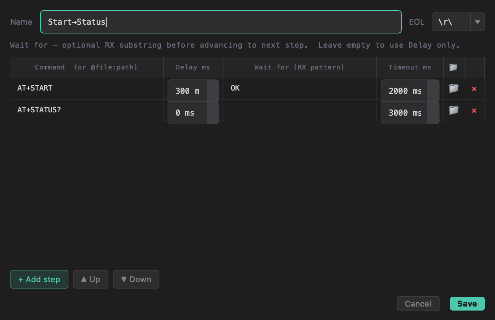

- Each step has a **command**, an optional **inter-step delay**, and an optional
  **wait-for RX pattern** with timeout (handshake-style sequencing)
- A step can send a file directly (`@file:path`) over serial
- "Run" executes the sequence; "Stop" aborts mid-run; live step progress (`2/3`)
- Macros are saved/loaded as part of the session settings

→ **[Macros guide](https://github.com/AlexShateljuk/isodaq/wiki/Macros)**

### Data logger

- Start / Stop session with one click
- **Dual sink**: CSV file + SQLite database written in parallel via a lock-free queue
- Formats: CSV (`timestamp, trigger, raw`) · JSON lines · raw text
- SQLite: WAL mode + batched `executemany` — no write contention at high data rates
- Configurable filename prefix and output directory
- Live stats: file size and row count, updated every 500 ms
- "Open folder" shortcut opens the log directory in the OS file manager

→ **[Data Logger guide](https://github.com/AlexShateljuk/isodaq/wiki/Data-Logger)**

### Session sharing (Share & Join)

Share live serial output with a colleague anywhere in the world — both sides just run
IsoDAQ Studio. No browser, no account, no extra dependencies (pure stdlib on both ends).
One host can stream to **multiple viewers** at once.

There are two ways to join, for two situations:

**1. By address — same network (LAN / VPN).** Direct TCP, lossless, lowest latency.

```
Host  ──────────  direct TCP :9876  ──────────  Viewer
   (192.168.x.x — shown in the Share dialog)
```

**2. By code — over the internet (through any NAT/firewall).** A small hosted
signaling+relay server brokers the connection; no router setup needed.

```
Host                     Signaling + Relay Server                Viewer(s)
  │── register (STUN IP) ───────>│                                  │
  │      → 6-digit code          │<──── look up code ───────────────│
  │── push serial lines ────────>│──── long-poll / deliver ────────>│
  │                              │   (relay forwards the stream)    │
```

1. **Share** — click Share. The app starts the local TCP server, discovers your public
   IP via STUN, registers a **6-digit code**, and enables the relay. The dialog shows the
   code, the LAN address, and a live **Viewers: N** count.
2. **Join** — your colleague clicks Join → **By code** → types the code. Data flows over
   the relay, so it works even behind strict NAT/corporate firewalls.

When you click **Stop**, all viewers are notified and leave automatically.

> **LAN vs relay trade-off:** the LAN/direct-TCP path is lossless and low-latency. The
> relay path is **best-effort** — under sustained very high throughput, or on a network
> hiccup, individual lines may be dropped from the relayed stream. The host's own
> terminal and data logger always capture the complete record regardless.

**Connection quality** is shown in the status bar as a coloured LED + latency:

| Colour | Latency |
|--------|---------|
| 🟢 Green | ≤ 80 ms |
| 🟡 Yellow | 81 – 250 ms |
| 🔴 Red | > 250 ms or timeout |

A public relay is already configured by default, so sharing works out of the box.
You can also **[host your own relay](https://github.com/AlexShateljuk/isodaq/wiki/Session-Sharing#hosting-your-own-relay)**
(pure-stdlib server in `relay/`, deployable to Railway in minutes).

→ **[Session Sharing guide](https://github.com/AlexShateljuk/isodaq/wiki/Session-Sharing)**

### Themes, modes & other niceties

<div align="center">

| Dark (VS Code) | Light |
|:---:|:---:|
|  | 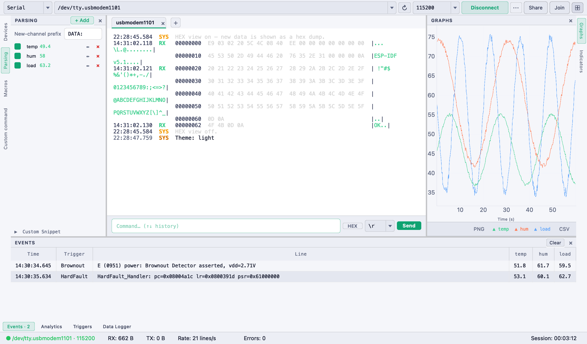 |

</div>

- **Themes** — Dark (`#1e1e1e` base, teal accents) and Light, switchable at runtime (`View → Theme`)
- **UI modes** — Advanced (full layout) and Simple (terminal-only), toggle with `Ctrl+Shift+M`
- **Command palette** (`Ctrl/Cmd+K`) and keyboard shortcuts: `Ctrl+F` find · `F4` detach tool window · `Ctrl+Shift+R` right panel
- **Auto-update check** — silent GitHub-Releases check on startup; a dismissible banner + OS notification appear if a newer version is out (`Help → Check for Updates` for a manual check)
- **Settings persistence** — all session state is saved on exit and restored next launch (`~/.isodaq_studio/config.json`)

→ **[Themes, Modes & Settings guide](https://github.com/AlexShateljuk/isodaq/wiki/Themes-Modes-and-Settings)**

---

## Architecture

```
Per connection (one per device tab):

Serial / Network / SSH reader (QThread)
    │  LineSplitter: one split per read, 4 KB line cap, control chars → "·"
    │  lines_received([(line, ts, arrival, raw_bytes), …])   one queued signal per read
    ▼
MainWindow._on_conn_lines()  → connection.rx_backlog                GUI thread
    ▼
MainWindow._drain_rx()   every 15 ms, ≤ 12 ms of work, round-robin over connections
    │   (lines > 1 s behind: logged + trigger-checked only, not drawn)
    ├──▶  Logger.write_line()          queue → _LogWriter thread → .csv / .json / .txt + SQLite (WAL)
    ├──▶  TriggerEngine.check()        → events table, analytics, flash, notifications
    ├──▶  DataParser.parse()           → chart / indicator buffers (redrawn ≤ 30 fps, only when visible)
    ├──▶  terminal queue               → batched paint ~30 fps (text or HEX dump)
    └──▶  SessionServer.feed_line()    → broadcast to viewers (active connection)

SessionClient (QThread)  ← viewer side
    └── line_received → MainWindow._on_remote_line()
```

See [docs/ARCHITECTURE.md](docs/ARCHITECTURE.md) for the full module map,
threading model, and a "where do I add…?" guide for contributors.

---

## Project structure

```
isodaq/
├── main.py                           # Entry point, version constant
├── requirements.txt
├── relay/                            # Signaling + relay server (deploy once to Railway)
│   ├── server.py                     # HTTP signaling + relay (fan-out, pure stdlib)
│   ├── Procfile                      # Railway/Heroku entry point
│   ├── nixpacks.toml                 # Pin Python build (don't auto-run main.py)
│   ├── railway.toml                  # Railway build/health config
│   ├── requirements.txt              # empty — stdlib only
│   └── README.md                     # Deploy instructions
├── core/
│   ├── connection.py                 # One device: transport + parser + triggers + logger + state
│   ├── stream_reader.py              # Shared reader base: read loop, LineSplitter, batched delivery
│   ├── serial_reader.py              # Local serial (COM / tty)
│   ├── net_reader.py                 # socket:// and rfc2217:// transports
│   ├── ssh_reader.py                 # SSH transport (paramiko)
│   ├── logger.py                     # Async dual-sink logger
│   ├── triggers.py                   # Trigger engine
│   ├── macros.py                     # Macro runner
│   ├── data_parser.py                # Channel extraction engine
│   ├── i18n.py                       # Lightweight JSON-catalog translations
│   ├── updater.py                    # GitHub Releases update checker
│   ├── session_server.py             # TCP session server (Share side)
│   ├── session_client.py             # TCP session client (Join side)
│   ├── signaling.py                  # Signaling server register/lookup client
│   ├── stun_helper.py                # STUN public IP discovery (stdlib only)
│   └── notifier.py                   # Telegram / webhook trigger notifier
├── ui/
│   ├── main_window.py                # Main window, layout, RX drain, terminal
│   ├── tool_window.py                # IDE-style edge stripes + docks
│   ├── command_palette.py            # Ctrl/Cmd+K command palette
│   ├── controllers/                  # Extracted controllers (serial, session, triggers, …)
│   ├── chart_panel.py                # pyqtgraph scrolling chart
│   ├── indicator_panel.py            # Live value indicator grid
│   ├── trigger_events_panel.py       # Trigger match event table
│   ├── parse_panel.py                # Parser channel editor
│   ├── trigger_panel.py              # Trigger editor
│   ├── macro_panel.py                # Macro editor
│   ├── logger_panel.py               # Logger controls
│   ├── log_colorizer_dialog.py       # Log colorizer settings
│   ├── analytics_panel.py            # Trigger hit analytics
│   └── themes.py                     # Dark / Light stylesheets
├── emulator/                         # Virtual serial port (loopback TCP) for testing
├── tools/
│   ├── gen_screenshots.py            # Regenerates the docs/ screenshots
│   └── gen_demo_gif.py               # Regenerates docs/images/demo.gif
├── translations/                     # i18n catalogs (uk.json, …)
└── docs/
    ├── ARCHITECTURE.md
    └── images/                       # README + wiki screenshots
```

---

## Performance

Measured with sequence-numbered test streams on virtual serial ports (the app's
real serial reader), logger and triggers on, on an Apple-Silicon Mac:

| Scenario | Result |
|----------|--------|
| 1 port @ 921 600 baud (~1 900 lines/s) | display delay ≈ 25 ms, no UI freeze, 0 lines lost |
| 4 ports @ 921 600 baud (~7 000 lines/s) | 0 lines lost; UI stays responsive |
| Flash dump: 1–8 KB packets back-to-back + 4 MB raw binary, logging to CSV + SQLite | 0 lines lost in either log, no crash |
| Everything at once (≈12 Mbit/s over 4 ports, triggers, user actions mid-load) | 0 lines lost in the logs; screen kept within ~1 s of live |

How:

| Component | Strategy |
|-----------|----------|
| Readers | `in_waiting` chunk reads; one split per read; lines delivered to the GUI **in batches** (one signal per read) |
| GUI | Received lines processed on a **time budget** (≤ 12 ms per 15 ms tick) so the window never freezes; if the display falls > 1 s behind, the excess is logged + trigger-checked but not drawn |
| Terminal | Batched paints (~30 fps), scrollback capped (5 000 lines default) |
| Charts / analytics | Redrawn on timers, only while visible; clip-to-view + peak downsampling |
| Logger | Lock-free queue → writer thread; CSV batches every 200 ms; SQLite `executemany`, WAL, `synchronous=NORMAL` |

→ **[Performance & High Data Rates](https://github.com/AlexShateljuk/isodaq/wiki/Performance-and-High-Data-Rates)**

---

## Requirements

```
PyQt6 >= 6.6        pyserial >= 3.5     numpy >= 1.26
PyQt6-sip >= 13.6   pyqtgraph >= 0.13   paramiko >= 3   (SSH transport)
```

Python **3.9+** (CI tests 3.9, 3.11 and 3.12). Exact tested versions: `constraints.txt`.

---

## Contributing

Contributions are welcome — see [CONTRIBUTING.md](CONTRIBUTING.md) for setup and
the checks CI runs (`ruff check .` + `pytest`). Please also read the
[Code of Conduct](CODE_OF_CONDUCT.md). Changes are tracked in
[CHANGELOG.md](CHANGELOG.md).

> **Regenerating the docs media:** the images under `docs/images/` are produced by
> `python tools/gen_screenshots.py` and the animated `demo.gif` by
> `python tools/gen_demo_gif.py` (both build the real window and feed synthetic
> data — no capture by hand). Re-run them after UI changes to keep the docs current.

## Security

Found a vulnerability? Please report it privately — see [SECURITY.md](SECURITY.md).
Note that `[python]` triggers and custom parser snippets execute arbitrary Python
by design; never enable Python rules from a config file you don't trust.

## License

IsoDAQ Studio is licensed under the **Apache License 2.0** — see [LICENSE](LICENSE)
and [NOTICE](NOTICE). You are free to use, modify, and distribute it, including for
commercial purposes, provided you retain the copyright/attribution notices.

Copyright 2026 eSOMtech.
