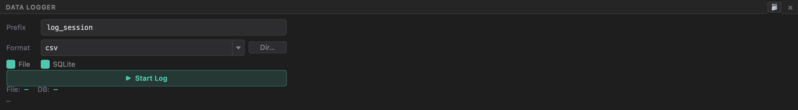

# Data Logger

The logger records the session to disk **in parallel** with everything else, using
two sinks at once. Controls live in the **Data Logger** tool window (bottom edge); each connection has its own logger.



## Controls

| Control | Purpose |
|---------|---------|
| **Prefix** | Filename prefix for this session (e.g. `log_session`). |
| **Format** | `csv` · `json` · `txt` · `raw` for the file sink. |
| **Dir…** | Choose the output directory (default `~/isodaq_logs/`). |
| **File** / **SQLite** | Enable/disable each sink independently. |
| **▶ Start Log / ⏹ Stop Log** | Begin/end the session. |

Below the button, live stats show the current **file size** and **DB row count**
(refreshed every 500 ms) and the paths being written. The **📂** button in the
header opens the log folder in your OS file manager.

<br clear="right">

## Dual-sink design

When you start logging, lines are handed to a **lock-free queue** and written by a
background daemon thread, so the serial reader never blocks on disk:

- **File sink** — writes `.csv` / `.json` / `.txt` / `.raw`. Lines are batched
  (256 at a time) and flushed periodically for throughput.
- **SQLite sink** — writes a `.db` in **WAL mode** with batched `executemany`
  (hundreds of rows per flush) and `synchronous=NORMAL`, so there's no write
  contention even at high data rates.

You can run **both** sinks simultaneously (default) or either one alone.

### CSV columns

The CSV format captures `timestamp, trigger, raw` — so a row records when a line
arrived, which [Trigger](Triggers) (if any) it matched, and the raw text.

## Triggers can control logging

A [Trigger](Triggers) with a **Pause log** or **Resume log** action can start/stop
the session automatically — for example, pause logging on a known-noisy phase and
resume when a `READY` line appears. Trigger matches can also drop a **marker** into
the log (the *Log* action).

## Recording a shared session

On the **viewer** side of [Session Sharing](Session-Sharing), pressing **▶ Start
Log** records the *received* stream exactly like a local serial feed — a colleague
can capture the host's data locally.

## Notes

- The logger writes the **complete** record regardless of the terminal's
  scrollback cap or **Clear** — the on-screen view and the log are independent.
- Stopping the session flushes and closes both sinks cleanly; the app also flushes
  on exit.

## Publish to MQTT

Sends this connection's data to a broker, for Grafana, Home Assistant, Node-RED or
anything else that speaks MQTT. It works with any transport and doesn't need a log
session. Enter a broker and base topic, then tick **Publish to MQTT**:

```
mqtt://broker.local/bench1
```

| Topic | Payload | When |
|-------|---------|------|
| `bench1/temp` | `21.5` | parsed channels and [Quick Plot](Live-Views#quick-plot) values |
| `bench1/event/Brownout` | `{"trigger": "Brownout", "line": "…", "ts": "…"}` | each [trigger](Triggers) match |

- Each channel is sent **at most 10 times a second**, always with its latest value. The
  log file is the complete record; this is a live feed.
- If the broker can't be reached the status line says so and it keeps retrying. Messages
  during an outage are skipped, not queued.
- Without a topic in the URL, the base topic is `isodaq`.
- The address is remembered, but publishing is **off at every start** until you tick it.
