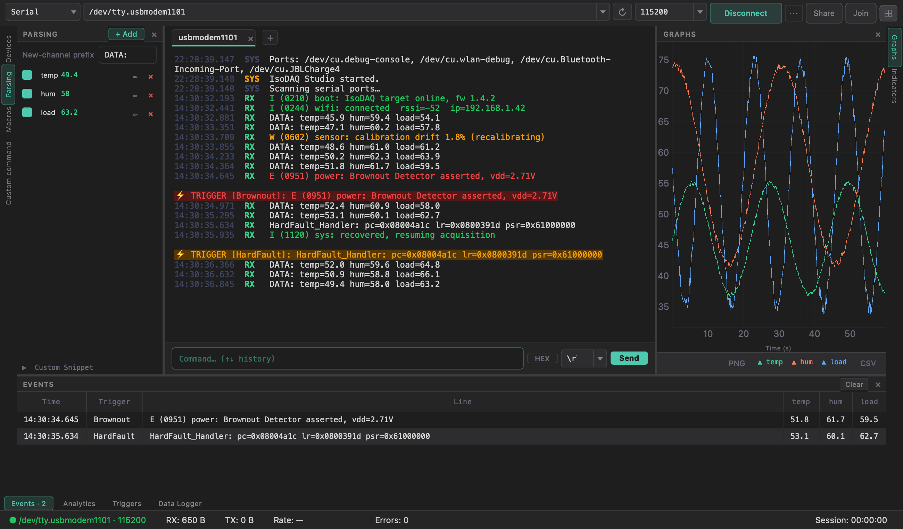

# IsoDAQ Studio — Wiki

A serial terminal and real-time data-acquisition frontend for embedded systems
development. Built with **Python 3 · PyQt6 · pyqtgraph**; runs on
**Windows · Linux · macOS**.

This wiki is the **detailed, page-per-feature manual**. For the short visual
overview, see the [project README](https://github.com/AlexShateljuk/isodaq#readme).

## What it does

Connect to one or **several devices at once** — USB serial, TCP / RFC 2217 or
SSH — and IsoDAQ Studio lets you:

- **Watch** the traffic scroll by with millisecond timestamps and per-line
  colour, optionally highlighted by **log level** for your platform — or as a
  **hex dump** for binary data.
- **Extract** named numeric channels from the stream with the [Data Parser](Data-Parser).
- **Visualise** them live as [charts, value cards, an event log and analytics](Live-Views).
- **React** to the lines that matter with [Triggers](Triggers) — flash, beep,
  log-marker, pause/resume logging, or webhook/Telegram notifications.
- **Automate** command sequences with [Macros](Macros).
- **Record** everything to CSV + SQLite in parallel with the [Data Logger](Data-Logger).
- **Share** the whole live session with a colleague anywhere via [Session Sharing](Session-Sharing).
- **Keep up** with fast links — several ports at 921 600 baud and flash dumps,
  without losing a line ([Performance](Performance-and-High-Data-Rates)).

Press **`Ctrl/Cmd+K`** anywhere for the command palette.

## Start here

| If you want to… | Read |
|-----------------|------|
| Install and make your first connection | [Getting Started](Getting-Started) |
| Understand the window layout | [Interface Overview](Interface-Overview) |
| Configure port / baud / framing, network or SSH | [Serial Connection](Serial-Connection) |
| Work with several devices at once | [Multiple Connections](Multiple-Connections) |
| Read + search the terminal | [Terminal](Terminal) · [Log Colorizer](Log-Colorizer) |
| Turn text into numbers | [Data Parser](Data-Parser) |
| Plot & inspect those numbers | [Live Views](Live-Views) |
| Alert on specific lines | [Triggers](Triggers) |
| Send command sequences | [Macros](Macros) |
| Log to disk | [Data Logger](Data-Logger) |
| Stream to a colleague | [Session Sharing](Session-Sharing) |
| Change theme / mode / settings | [Themes, Modes & Settings](Themes-Modes-and-Settings) |
| Build a binary / release | [Building From Source](Building-From-Source) |
| Stream fast data / flash dumps | [Performance & High Data Rates](Performance-and-High-Data-Rates) |
| Fix a problem | [FAQ & Troubleshooting](FAQ-and-Troubleshooting) |

## A note on safety

`[python]` triggers and custom parser snippets **execute arbitrary Python code**
by design. IsoDAQ Studio will not run Python rules loaded from a file until you
explicitly review and enable them, but you should still only enable code from
sources you trust. See [Triggers → Security](Triggers#security).
