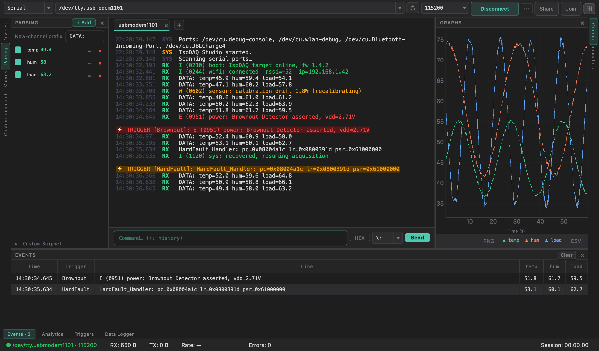
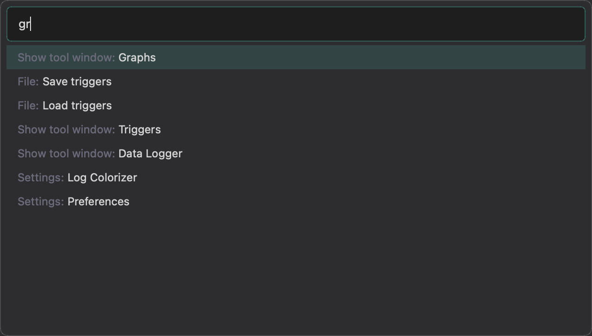
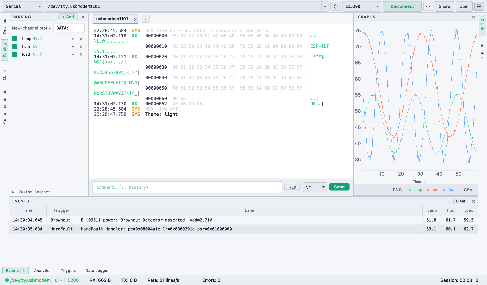

# Interface Overview

IsoDAQ Studio uses an **IDE-style layout** (think IntelliJ / VS Code). The
**terminal** is the "editor" in the middle; every other feature is a **tool
window** docked to the left, right or bottom edge. A connection toolbar runs
across the top and a status bar across the bottom.

| Region | Purpose | More |
|--------|---------|------|
| **Connection toolbar** (top) | Transport (Serial / Network / SSH), port or URL, ↻ rescan, baud, Connect, `⋯` options, Share & Join | [Serial Connection](Serial-Connection) |
| **Connection tabs** | One tab per device, `+` adds one; the toolbar, terminal and every tool window follow the active tab | [Multiple Connections](Multiple-Connections) |
| **Terminal** (centre) | Timestamped, colour-coded RX/TX output, HEX view; `Ctrl+F` searches | [Terminal](Terminal) |
| **Command input** | Send line, `HEX` toggle, EOL selector, `↑ ↓` history | [Terminal](Terminal#sending-commands) |
| **Edge stripes** | The names of the tool windows on each edge — click to open / collapse | below |
| **Status bar** | Connection state, RX/TX bytes, live line rate, errors, session time | below |

## Tool windows

| Edge | Tool windows |
|------|--------------|
| **Left** | **Devices** (all connections and their state) · **Parsing** · **Macros** · **Custom command** |
| **Right** | **Graphs** · **Indicators** · **Controls** |
| **Bottom** | **Events** · **Analytics** · **Triggers** · **Data Logger** · **Flash** · **Modbus** · **Binary frames** |

- Click a name on a stripe to open that tool window; click it again (or the `×`
  in the tool window's header) to collapse it back to the stripe.
- One tool window per edge is open at a time; the **Events** stripe shows the
  event count (`Events · 12`).
- Tool-window headers carry their actions — e.g. **+ Add** on Parsing,
  Macros and Triggers, **Clear** on Events.
- **`F4`** (View → Detach Tool Window) pops the open tool window out into its own
  resizable window (handy on a second monitor); closing it docks it back.
- Which tool windows are open is remembered next launch.

→ [Data Parser](Data-Parser) · [Live Views](Live-Views) · [Triggers](Triggers) ·
[Macros](Macros) · [Data Logger](Data-Logger)

## Command palette

**`Ctrl/Cmd+K`** (or `Ctrl/Cmd+Shift+P`, View → Command Palette…) opens a search
box over everything the app can do:

- Connect / disconnect, new / close / switch connection, rescan ports
- Open any tool window
- Toggle HEX view, timestamps, autoscroll, echo (the entry shows the current state)
- Font size, theme, and every menu item

Type a few letters — matching is fuzzy, so `hx` finds *HEX view* and `gr` finds
*Graphs*. `↑ ↓` select, `Enter` runs, `Esc` closes.

## The menu bar

| Menu | Contains |
|------|----------|
| **File** | Save / Load triggers, Exit |
| **Device** | Refresh ports, Build & flash (`F5`), Send file (XMODEM / YMODEM) |
| **View** | Command Palette… (`Ctrl+Shift+P`), Find… (`Ctrl+F`), Simple Mode (`Ctrl+Shift+M`), Right Panel (`Ctrl+Shift+R`), Detach Tool Window (`F4`), Theme |
| **Settings** | Log Colorizer…, Preferences… |
| **Help** | Check for Updates, About |

## The status bar

Left to right, for the **active connection**: state (`● PORT · BAUD` when
connected, `● Connection failed` in red after an error), **RX** and **TX** bytes,
**Rate** (lines per second), **Errors** (red when non-zero), an optional
remote-session latency LED (only while joined to a shared session), and the
**Session** timer (time connected).

## Layout modes

`View → Simple Mode` (`Ctrl+Shift+M`) toggles between:

| Mode | What's visible |
|------|----------------|
| **Advanced** (default) | Full layout — toolbar, terminal, edge stripes and tool windows |
| **Simple** | Toolbar, terminal and command input only |

The mode is persisted across sessions. → [Themes, Modes & Settings](Themes-Modes-and-Settings)

## Themes

Two themes, switchable at runtime via `View → Theme` (or the command palette):

| Dark (VS Code) | Light |
|:---:|:---:|
|  |  |
