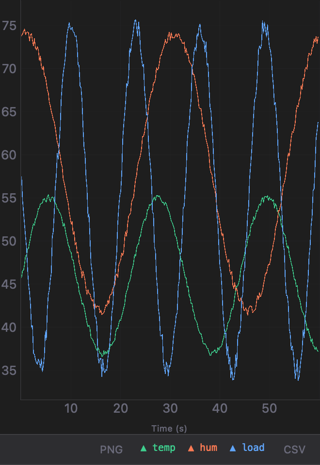
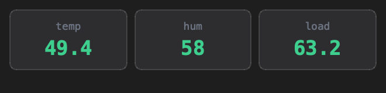
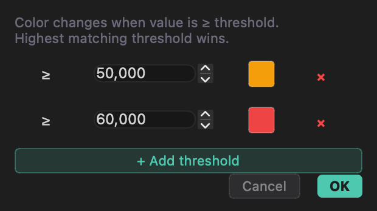
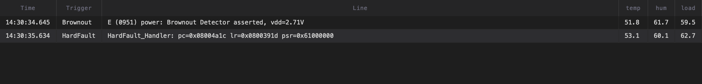
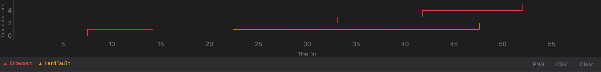

# Live Views

Four tool windows visualise the parsed channels and trigger activity: **Graphs**
and **Indicators** on the right edge, **Events** and **Analytics** at the bottom.
Each connection has its own set; they follow the active tab. Any of them can be
**popped out** into its own window with **`F4`** (close it to dock it back).

Channels appear here once you tick **Add to Chart** / **Add to Indicators** in the
[Data Parser](Data-Parser).

## Graphs

Real-time scrolling line chart (pyqtgraph):

- Up to **8 simultaneous channels**, each with a distinct colour.
- A rolling **time window** — 10 s, 30 s, **1 min** (default), 5 min, 15 min or
  **All** (everything buffered) — picked in the footer.
- A **ring buffer** per channel of 2k, **20k** (default), 100k or 500k points —
  old points age out, memory stays bounded.
- **❚❚ Pause** freezes the view while data keeps recording — pan and zoom
  freely, then **▶** to follow live again.
- **Y🔒** locks the vertical range at its current span (off = auto-scale).
- **Mouse pan and zoom** on both axes.
- A colour **legend strip** below the chart names each channel.
- **PNG** exports the plot as an image; **CSV** exports the buffered data (a
  unified time index with one column per channel).

### Quick Plot

Lines that are **only data** are plotted straight away — no channel to set up:

| Device prints | Series |
|---------------|--------|
| `12.5, 40, -3` (comma / space / tab separated) | `ch1`, `ch2`, `ch3` — like the Arduino Serial Plotter |
| `temp:21.5 hum:40%` or `temp=21.5, rpm=1500` | `temp`, `hum` / `temp`, `rpm` |
| `>temp:21.5` · `>temp:<ms>:21.5` · `>temp:21.5§°C` | `temp` — [Teleplot](https://github.com/nesnes/teleplot) format, so firmware already using a Teleplot library works unchanged |

- The **whole line** must be data, so ordinary log lines
  (`Free heap: 12345 bytes`, `I (123) wifi: connected`) are never plotted.
  Teleplot text (`|t`), XY (`|xy`), no-plot (`|np`) and 3D lines are ignored.
- Quick Plot series show a hollow **△** in the legend. **Right-click** one to
  **Keep as Parsing channel** (it becomes a normal [channel](Data-Parser) you can
  scale, put on an indicator and keep across restarts) or **Hide this series**.
- A name that a Parsing channel already uses follows that channel instead.
- **Auto** in the footer turns Quick Plot off (and removes its series) or back
  on. Up to 16 series are added automatically.

## Indicators

A responsive grid of large value cards — one per channel — updated on every
parsed data point.

**Colour thresholds:** double-click a card to open its threshold editor. Add
`≥ value → colour` rules; the highest matching threshold wins, otherwise the
card's base colour is used. This turns a card red when a reading crosses a limit,
green when it's healthy, and so on.

## Trigger Events

A session log of every [Trigger](Triggers) match:

- Columns: **Time · Trigger · Raw line**, plus **one column per active parsed
  channel** (so you see the channel values captured at the moment the trigger
  fired).
- Alternating row colours, row selection, non-editable.
- An event counter in the header; **Clear** empties the table.
- **Double-click a row** to jump the terminal to the exact line that fired the
  trigger.

## Analytics

A cumulative **hit-count staircase** per trigger: X = elapsed seconds,
Y = total hits. The step shape makes **burst periods and quiet periods** obvious
at a glance — a wall of steps means something is firing repeatedly.

- The trigger list here stays in sync with your [Triggers](Triggers) automatically.
- **PNG** / **CSV** export the chart / the raw `(time, trigger)` hit records.
- **Clear** resets the curves and the time origin.

## Pop-out

Press **`F4`** (View → Detach Tool Window) to detach the open tool window into a
standalone window — for example, put **Graphs** on a second monitor while you
keep the terminal in focus. The window inherits the current theme; closing it
docks the tool window back.

## Performance

Charts and analytics are redrawn on a timer (at most ~30 times a second) and
only while they are visible, so a hidden chart or a background connection costs
almost nothing; it catches up when shown. The Events table keeps the newest
5 000 rows (the counter keeps the total).
