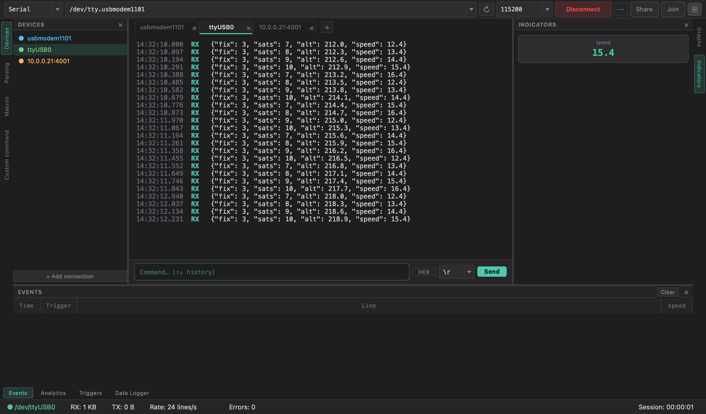

# Multiple Connections

IsoDAQ Studio can talk to **several devices at once** — for example a sensor board
on USB, a GPS module on a second port and a motor controller behind a network
serial server. Each one is a **connection**, shown as a tab above the terminal.

## Adding, switching, closing

- **`+`** next to the tabs (or *New connection* in the [command palette](Interface-Overview#command-palette))
  adds a connection. Pick its transport, target and baud in the toolbar and
  click **Connect** — exactly as for the first one ([Serial Connection](Serial-Connection)).
- **Click a tab** (or a row in the **Devices** tool window, or *Switch to …* in
  the command palette) to make it active.
- **`×`** on a tab closes that connection (its port is disconnected and its
  logger stopped). The last connection can't be closed.

Tabs show a short name — `tty.usbmodem1101` becomes `usbmodem1101`,
`socket://10.0.0.21:4001` becomes `10.0.0.21:4001` — with the full name in the
tooltip. If there are more tabs than fit, the strip scrolls.

## What belongs to each connection

Everything that has to do with a device's data is **per connection**:

| Per connection | Shared by the window |
|----------------|----------------------|
| Transport, target, baud (the toolbar shows the active one's) | Menus, theme, mode |
| Terminal (and its HEX offsets) | Command palette |
| [Parser](Data-Parser) channels | [Macros](Macros) and *Custom command* (they send to the active connection) |
| [Graphs](Live-Views#graphs) and [Indicators](Live-Views#indicators) | [Session sharing](Session-Sharing) (shares the active connection) |
| [Triggers](Triggers), [Events](Live-Views#trigger-events), [Analytics](Live-Views#analytics) | |
| [Data Logger](Data-Logger) session and files | |
| Status bar figures: RX/TX, rate, errors, session time | |

Switching tabs swaps all of the per-connection views at once.

## Background connections keep working

A connection whose tab isn't active keeps receiving, parsing, logging and
charting. Its **triggers fire too** — events, analytics, notifications
(Telegram / webhook) and the flash banner in its own terminal — so you can watch
one device while another raises an alert.

## The Devices tool window

The **Devices** tool window (left edge) lists every connection with its state:

| Mark | Meaning |
|------|---------|
| ● (in the connection's colour) | connected |
| ○ | idle — not connected |
| ✕ (red) | the last connect attempt failed, or the link was lost |

A failed connection also shows a red tab, `● Connection failed` in the status bar
and a non-zero **Errors** count. It clears on the next successful connect.
**+ Add connection** at the bottom adds a new one.

## Performance

Several fast connections at once are fine — for example four ports at 921 600 baud
are processed without losing a line. See
[Performance & High Data Rates](Performance-and-High-Data-Rates).
