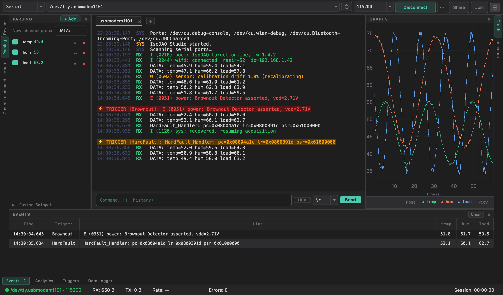
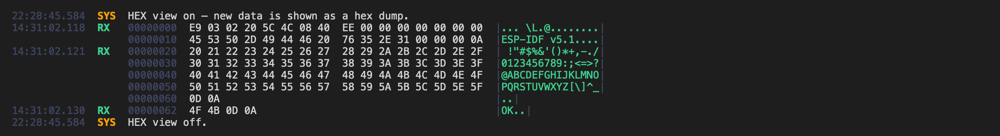

# Terminal

The terminal is the scrolling record of everything sent and received on the
port. Each [connection](Multiple-Connections) has its own terminal; the one shown
belongs to the active tab.

## Line colours

Each line is tagged by direction:

| Tag | Meaning | Colour |
|-----|---------|--------|
| `RX` | received from the device | green |
| `TX` | sent by you | orange |
| `SYS` | app messages (connect, theme, …) | amber |
| `ERR` | errors | red |

When the [Log Colorizer](Log-Colorizer) is active, **RX** lines are additionally
recoloured by log level (INFO green / WARN amber / ERROR red) based on your
platform's log format.

## Display toggles (`⋯` in the toolbar, or the command palette)

| Toggle | Effect |
|--------|--------|
| **Timestamp** | Prefix every line with `HH:MM:SS.mmm` (millisecond precision) |
| **HEX** | Show incoming data as a hex dump — also a one-click **`HEX`** button next to the command box; see [HEX view](#hex-view) |
| **Autoscroll** | Keep the newest line in view; turns off automatically while you scroll up, and snaps back when re-enabled |
| **Echo** | Mirror what you send (TX) back into the terminal |

## Font size & scrollback

- **Font − / +** (under `⋯`, or *Increase / Decrease font size* in the command palette) steps the terminal font between **8 and 24 pt**; the size is
  persisted across sessions and applies to existing text immediately.
- The scrollback is capped (default **5 000 lines**) so long sessions don't grow
  memory without bound; the oldest lines are trimmed first. The limit is
  configurable in **Preferences**. → [Themes, Modes & Settings](Themes-Modes-and-Settings)
- **Clear** empties the terminal (it does **not** stop logging).

## Sending commands

The input row at the bottom sends a single line:

- **EOL selector** — choose the terminator appended to what you send: `\r\n`,
  `\n`, `\r`, or **None**.
- **History** — **↑ / ↓** cycle through previously sent commands.
- **Custom command** — the *Custom command* tool window (left edge) holds a
  free-text box for a longer or reused command, sent with its own button.

### Hex commands and checksums

The button to the left of **Send** says how commands go out. It reads `Text` by default and
lights up when it changes the bytes you send.

- **Type commands as: Hex bytes** — type `01 03 00 00 00 02`, `0x55 0xAA` or `55AA`. A hex
  command gets no line ending, since it is usually a binary frame, and the terminal shows
  the whole frame byte for byte.
- **Append checksum** — Sum-8, XOR-8, LRC-8, CRC-8, CRC-8/Maxim, CRC-16/Modbus,
  CRC-16/CCITT (the `FALSE` variant), CRC-16/XMODEM or CRC-32. It goes before the line ending.
- **Checksum as** — raw bytes in either order (choosing a checksum selects its usual order:
  low byte first for Modbus, high byte first for the others), hex text, or `*` and hex text
  as NMEA uses it, which leaves a leading `$` or `!` out of the sum.

With text commands the terminal shows the checksum after the command: `$AB   [*03]`. The
checksum also goes on repeated commands, [Controls](Controls) and trigger replies, but not
on [Macros](Macros) or files you send.

### Repeating a command

In the *Custom command* tool window, set **Every** (milliseconds, 10 or more) and **Times**
(0 repeats until stopped), then **Repeat**. The frame is fixed when it starts. A repeat
belongs to the current device and carries on while you look at another tab; the status bar
shows it while that device is active. It stops if a send fails or the connection closes,
and doesn't restart after a reconnect, since the device may have reset.

For scripted, multi-step command flows (with delays and wait-for-response),
use [Macros](Macros).

## Search

Press **`Ctrl+F`** (or `View → Find…`) to open the in-terminal find bar:

- Type to search; **▲ / ▼** jump between matches; a hit counter shows
  `current/total`.
- **Aa** toggles case sensitivity.
- Matches are highlighted in place.

The terminal also supports **jump-to-line** from the [Trigger Events](Live-Views#trigger-events)
table — double-clicking an event row scrolls the terminal to the exact line that
fired the trigger.

## HEX view

Click **`HEX`** next to the command box (or toggle it from `⋯` / the command
palette) to show received data as a classic hex dump — for flash dumps, binary
protocols, or when you suspect non-printable characters:

- Each received chunk becomes rows of **offset · 16 bytes · |ASCII|**; non-printable
  bytes show as `.` in the ASCII column.
- The **offset** is the running byte count of this connection, so it matches the
  position in the stream (and in a flash image you read out).
- **Every byte is shown**, including the CR/LF line endings and empty lines.
- The setting applies to data **as it arrives** — lines already on screen keep
  their format when you switch.
- It only changes the display: the [Data Parser](Data-Parser), [Triggers](Triggers)
  and the [Data Logger](Data-Logger) keep working on the text.
- Tip: close the side tool windows for a wide terminal so the 16-byte rows don't
  wrap.

In text mode, control characters (NUL, BEL, …) are shown as `·`.

## Under heavy load

At very high data rates the terminal paints in batches (~30 times a second). If
the display falls more than a second behind, the oldest lines are still logged
and checked by triggers but not drawn, and a `SYS` line tells you how many were
skipped once the display catches up. → [Performance & High Data Rates](Performance-and-High-Data-Rates)

## What gets recorded

The terminal is a *view*. To persist the stream to disk (independently of what's
on screen or the scrollback cap), start the [Data Logger](Data-Logger) — it
captures the complete record to CSV + SQLite regardless of terminal trimming.
