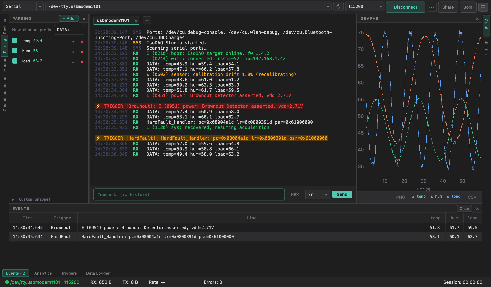
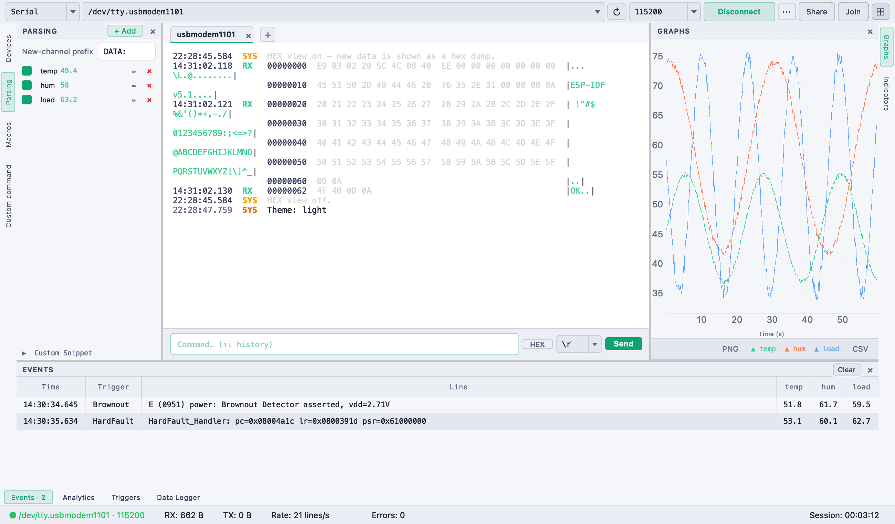

# Themes, Modes & Settings

## Themes

Switch at runtime via `View → Theme`:

| Theme | Look |
|-------|------|
| **Dark (VS Code)** | `#1e1e1e` base with teal accents (default) |
| **Light** | off-white base with green accents |

| Dark | Light |
|:---:|:---:|
|  |  |

The choice applies immediately to the whole app (including open dialogs and
pop-out windows) and is remembered next launch.

## Layout modes

`View → Simple Mode` (**`Ctrl+Shift+M`**) toggles:

| Mode | What's visible |
|------|----------------|
| **Advanced** (default) | Toolbar, terminal, edge stripes and tool windows |
| **Simple** | Toolbar, terminal and command input only |

In Advanced mode every tool window collapses to its edge stripe, so the terminal
can take the whole window; **`⊞`** / **`Ctrl+Shift+R`** shows or hides the right
edge (Graphs / Indicators). The mode and the open tool windows are persisted
across sessions. → [Interface Overview](Interface-Overview)

## Keyboard shortcuts

| Shortcut | Action |
|----------|--------|
| `Ctrl/Cmd+K` · `Ctrl/Cmd+Shift+P` | [Command palette](Interface-Overview#command-palette) |
| `Ctrl+F` | Find in terminal |
| `F4` | Detach the open tool window |
| `Ctrl+Shift+M` | Simple / Advanced mode |
| `Ctrl+Shift+R` | Show / hide the right tool windows |
| `↑ / ↓` (command box) | Command history |

## Preferences

`Settings → Preferences…` covers app-wide options, including:

- **Terminal scrollback limit** (default 5 000 lines)
- **Signaling server URL** for [Session Sharing](Session-Sharing) (point at your
  own relay if you host one)
- **Language** — see below

## Language (i18n)

IsoDAQ Studio uses a lightweight JSON-catalog translation system
(`translations/<code>.json`). Language selection priority at startup:

1. the saved preference, then
2. the `ISODAQ_LANG` environment variable, then
3. the system locale, then
4. English.

A change takes effect on the **next launch** (strings are resolved as the UI is
built). Contributing a translation is just adding a `translations/xx.json` file —
see [CONTRIBUTING.md](https://github.com/AlexShateljuk/isodaq/blob/master/CONTRIBUTING.md).

## Auto-update check

About 2 seconds after launch, the app silently queries the GitHub Releases API. If
a newer version tag is found:

- a dismissible **banner** appears at the top of the window with a **Download**
  button, and
- an **OS notification** fires (macOS / Windows) — clicking it opens the release
  page.

`Help → Check for Updates` runs a manual check at any time.

## Settings persistence

All session state — connection settings, parser channels, triggers, macros,
theme, mode, font size, scrollback, window layout — is saved on exit and restored
on next launch.

- **Config file:** `~/.isodaq_studio/config.json`

A backup save also fires on `aboutToQuit`, so state is preserved even if the
process is terminated without a normal close.
