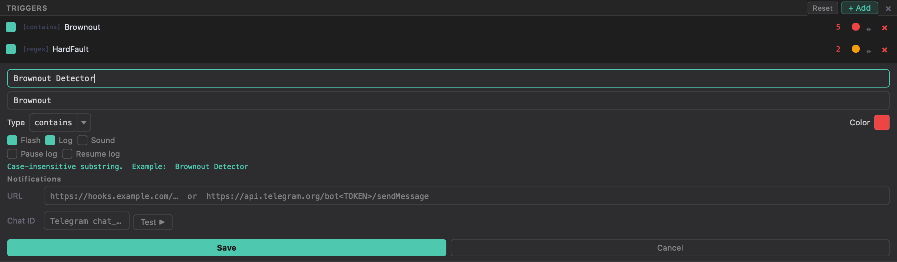

# Triggers

A trigger is a rule tested against **every incoming RX line** in real time. When a
line matches, the trigger fires its configured **actions**. Manage triggers in the
**Triggers** tool window (bottom edge). Each connection has its own triggers, and they fire even when that connection's tab is in the background.



## Rule types

| Type | Matches | Example |
|------|---------|---------|
| **contains** | case-insensitive substring | `Brownout Detector` |
| **regex** | Python regular expression (IGNORECASE) | `hard.?fault\|HardFault_Handler\|ERR_\d+` |
| **checksum** | a line ending in `*HH` whose checksum is wrong | `xor8` |
| **python** | a `lambda line: …` predicate returning bool | `lambda line: 'ERR' in line and '=' in line` |

You can set the type explicitly in the editor, or **prefix** the pattern and let
the app detect it: `[regex] …`, `[checksum] …`, `[python] …`. Plain text defaults
to *contains*.

For **checksum** the pattern names the algorithm: `sum8`, `xor8`, `lrc8`, `crc8`,
`crc8-maxim`, `crc16-modbus`, `crc16-ccitt`, `crc16-xmodem` or `crc32`. `xor8` checks NMEA
sentences. Only lines ending in `*` and the right number of hex digits are checked, so
ordinary log lines never fire it. It works on text lines; binary frames aren't checked.

## Actions

Tick any combination per trigger:

| Action | Effect |
|--------|--------|
| **Flash** | Insert a coloured banner line in the terminal at the match |
| **Log** | Write a `TRIGGER` marker into the active log sinks |
| **Sound** | System beep |
| **Pause log** | Stop the active logging session |
| **Resume log** | Restart a stopped logging session |
| **Reply** | Send text back to the device (auto-response) — see below |
| **Save snapshot** | Save the lines around the match to a file — see below |

### Auto-reply

Fill in **Reply** to answer the device automatically whenever the trigger
matches — log in to a console, acknowledge a frame, answer a prompt:

| Trigger | Reply | Device gets |
|---------|-------|-------------|
| `login:` | `root` | `root⏎` |
| `[regex] PING (\d+)` | `PONG \1` | `PONG 42⏎` for `PING 42` |
| `[regex] REQ id=(?P<id>\w+)` | `ACK \g<id>` | `ACK a7⏎` |
| `Press any key` | `\x1B` | ESC (no text) + line ending |

- Regex triggers can insert captured groups: `\1` … `\9`, `\g<name>`.
- Escapes: `\r \n \t \0 \xHH` (any byte), `\\` for a backslash.
- The command bar's **line ending** (`\r\n`, `\n`, …) is appended.
- The reply shows in the terminal as `TX ↩ …  [trigger name]` and counts in TX;
  rules with a reply show **↩** in the list.
- **Loop guard**: if the same trigger fires again within 100 ms its reply is
  skipped (a device that echoes your reply would otherwise loop forever); the
  terminal says so once.

Every match also increments the trigger's **hit counter** (shown live in the
list), records a row in the [Trigger Events](Live-Views#trigger-events) table, and
adds a step to the [Analytics](Live-Views#analytics) staircase. **Reset** in the
Triggers header clears the hit counters.

<br clear="right">

### Snapshots

**Save snapshot** writes the lines before and after each match to a text file, up to 1000
of each, in the Data Logger's folder under `snapshots/`, for example
`Brownout_20261106_142530.txt`. Matching lines are marked `>>`:

```
# IsoDAQ snapshot: Brownout
# Device: /dev/cu.usbserial-0001
# Time: 2026-11-06 14:25:30
# Pattern: [contains] Brownout

14:25:30.102      I (340) sensor: reading 7
14:25:30.214  >>  E (360) Brownout detector was triggered
14:25:30.561      I (0) boot: restart
```

- A fault often stops the output, so a snapshot is written with what it has after 10 seconds
  without a line, or 60 seconds after the match, and says how many lines it is short.
- While a snapshot is open, more matches are only marked in it. New snapshots of one rule
  are at least 5 seconds apart, and the file notes any matches skipped. A session saves at
  most 500, and says so when it stops.
- Lines received during an overload are included, even though the terminal skipped drawing them.
  Commands you send aren't.

**Send to the URL below** also sends the text to the rule's notification URL (see
[Security](#security)): a webhook gets a `snapshot` field with up to 256 KB, and Telegram gets
the last 3900 characters, since it limits message length.

## Notifications (webhook / Telegram)

Each trigger can POST a notification when it fires:

- **URL** — a generic webhook (receives JSON `{trigger, line, ts, text}`), **or**
  a full Telegram `sendMessage` URL
  (`https://api.telegram.org/bot<TOKEN>/sendMessage`).
- **Chat ID** — the Telegram `chat_id` (ignored for generic webhooks).
- **Test ▶** — send a test notification immediately to verify the setup.

## Saving & loading

Triggers are stored as JSON:

- `File → Save triggers…` writes the current list to a `.json` file.
- `File → Load triggers…` reads one back.

They're also part of your persisted session settings, so your working set
survives a restart without an explicit save.

## Security

`[python]` triggers **execute arbitrary code** whenever a line matches. To keep
you safe:

- When you **load a trigger file** containing Python rules, IsoDAQ Studio warns
  you and lets you choose **Load & enable**, **Load disabled**, or **Cancel**.
- Rules loaded **disabled** stay *blocked* — their code is never evaluated — until
  you open the rule in the editor and explicitly enable it.

A trigger file can also contain notification URLs, so check the rules in files from others:
a rule with a URL sends each matching line there. Loading a file always switches off sending
snapshots to a URL, whatever the file says; switch it on in the rule's editor if you want it.

Only enable Python rules from sources you trust. See
[SECURITY.md](https://github.com/AlexShateljuk/isodaq/blob/master/SECURITY.md).

## Examples

| Goal | Pattern | Type |
|------|---------|------|
| Catch a brownout | `Brownout Detector` | contains |
| Any hard fault variant | `hard.?fault\|HardFault_Handler` | regex |
| Error codes | `ERR_\d+` | regex |
| Value over a limit | `lambda line: 'temp=' in line and float(line.split('temp=')[1].split()[0]) > 80` | python |
